# Stanza Cross-Chain: License It From Anywhere

> **NEAR Beyond Boundaries Hackathon 2026**  
> **Tracks:** Real World, Autonomous Agents, Business, Open  
> **Status:** Built Nov 5, 2026. Verified green across contract, agent, and UI suites.

---

## Overview

**Stanza Cross-Chain** allows researchers, institutions, and readers to license scholarly works from **any blockchain** (NEAR, Solana, Ethereum, Arbitrum, Base) in a single non-custodial action:

1. **Buyer deposits** native crypto (NEAR, SOL, ETH, or USDC) on their home chain.
2. **NEAR Intents 1Click API** settles USDC on Base mainnet (chain 8453) directly to the scholar's address.
3. **NEAR Chain Signatures MPC** (threshold signature network, contract `v1.signer`, derivation path `ethereum-1`) signs the on-chain license record transaction on Base.
4. **Base `LicenseRegistry.sol`** records the immutable license attestation, verifies caller is `onlyRelayer`, enforces replay protection, and credits the scholar in STANZA recognition.

```mermaid
sequenceDiagram
    autonumber
    actor Buyer as Buyer (Any Chain)
    participant UI as Stanza Checkout (Inertia/React 19)
    participant OneClick as NEAR Intents 1Click API
    participant Agent as Laravel Autonomous Watcher
    participant MPC as NEAR MPC Contract (v1.signer)
    participant Base as Base Mainnet (LicenseRegistry.sol)
    actor Scholar as Scholar Address

    Buyer->>UI: Select Work, Tier & Origin Asset (e.g. NEAR / SOL)
    UI->>Agent: Request Quote (POST /api/quote)
    Agent->>OneClick: POST /v0/quote (Exact Output USDC Base)
    OneClick-->>Agent: Unique Deposit Address & Quote ID
    Agent-->>UI: Display Deposit Address to Buyer
    Buyer->>OneClick: Deposit Asset to 1Click Address
    OneClick->>Scholar: Settle USDC Proceeds on Base
    OneClick-->>Agent: Status: SUCCESS (depositTxHash)
    
    rect rgb(20, 30, 25)
    Note over Agent: 4-Gate Pre-Signing Verification<br/>1. Status == SUCCESS<br/>2. amountOut & destination match scholar<br/>3. workId, tier, buyer match<br/>4. isSettled(proofHash) == false
    end

    Agent->>MPC: Call `sign` (payload = txHash, path = ethereum-1)
    MPC-->>Agent: RSV Threshold Signature
    Agent->>Base: Relay signed recordLicense(buyer, workId, tier, proofHash)
    Base-->>Base: Enforce onlyRelayer & settled[proofHash]
    Base-->>Buyer: Emit LicenseRecorded & ScholarCredited
```



---

## Locked Security Story

1. **NO EVM Private Key Anywhere**:
   - No EVM private key exists in this repository, in `.env`, on the server, or in memory.
   - The transaction to record licenses on Base is authorized exclusively by NEAR Chain Signatures MPC.
2. **`onlyRelayer` Gating**:
   - `LicenseRegistry.sol` restricts `recordLicense(...)` with `if (msg.sender != relayer) revert NotRelayer()`.
   - The constructor immutable `relayer` is strictly the deterministic EVM address derived from the NEAR MPC root key via path `ethereum-1`.
3. **Cryptographic Replay Protection**:
   - Every 1Click payment generates a unique `proofHash = keccak256(depositTxHash)`.
   - `LicenseRegistry.sol` maintains `mapping(bytes32 => bool) public settled`. A payment can never be reused or replayed to mint duplicate licenses.
4. **Pre-Signing 4-Gate Verification**:
   Before requesting any MPC signature, the watcher agent cryptographically verifies:
   - 1Click status is `SUCCESS`.
   - `amountOut` and `destination` match the scholar address and quote exactly.
   - `work_id`, `tier`, and `buyer_address` match the licensed entity.
   - `isSettled` on Base RPC is `false`.
5. **Proceeds Separation**:
   - 1Click USDC settles directly to the author/scholar address set per work.
   - The MPC derived relayer holds only gas ETH for Base execution; it never custodies author proceeds.

---

## Contract Deployments & Addresses

| Network | Contract / Asset | Address | Details |
| :--- | :--- | :--- | :--- |
| **Base Mainnet (8453)** | `LicenseRegistry.sol` | *Deploy Block: Fri Nov 6* | [LicenseRegistry.sol](src/LicenseRegistry.sol) |
| **NEAR Mainnet** | MPC Signer Contract | `v1.signer` | Root key: `3tFRbM...` |
| **Derivation Path** | MPC Path | `ethereum-1` | Relayer EVM Address |
| **Base USDC** | Settlement Asset | `0x833589fCD6eDb6E08f4c7C32D4f71b54bdA02913` | Direct scholar proceeds |

---

## "Do X → See Y" Cold Verification Steps

Run these commands directly in your shell from a fresh clone to verify every subsystem.

### Step 1: Verify Smart Contracts & Replay Protection (Foundry)

```bash
export PATH="$HOME/.foundry/bin:$PATH"
forge test -vvv
```

**Expected output:**
```
Ran 4 tests for test/LicenseRegistry.t.sol:LicenseRegistryTest
[PASS] testNonRelayerReverts() (gas: 39598)
[PASS] testRecordLicenseByRelayer() (gas: 80753)
[PASS] testReplayReverts() (gas: 105480)
[PASS] testUnknownWorkReverts() (gas: 48804)
Suite result: ok. 4 passed; 0 failed; 0 skipped
```

---

### Step 2: Verify NEAR Chain Signatures MPC Derivation (Path `ethereum-1`)

Derive the deterministic EVM address for any NEAR account without third-party dependencies:

```bash
# Run the internal verification test suite
python3 scripts/derive-mpc-address.py --test

# Derive EVM relayer address for a NEAR account
python3 scripts/derive-mpc-address.py example.near
```

**Expected output:**
```
Running Chain Signatures derivation verification tests...
  [PASS] Mainnet example.near + ethereum-1 -> 0xEF4Ea05e5c11057DeCC8E1bd6F5369f2acD91fA5
  [PASS] Testnet example.near + ethereum-1 -> 0x6787a751B4592A3871267c320C19cA01e5aBAec4
All derivation tests passed successfully!

==================================================
  NEAR Chain Signatures — MPC Derived Relayer Address
==================================================
  NEAR Account ID : example.near
  Derivation Path : ethereum-1
  Network         : mainnet (v1.signer)
  Derived EVM     : 0xEF4Ea05e5c11057DeCC8E1bd6F5369f2acD91fA5
==================================================
```

---

### Step 3: Dry-Run Base Mainnet Deployment Script Against Fork

Simulate deployment of `LicenseRegistry.sol` to Base (chain 8453) using the derived MPC relayer address:

```bash
RELAYER_ADDRESS=0xEF4Ea05e5c11057DeCC8E1bd6F5369f2acD91fA5 \
  forge script script/DeployLicenseRegistry.s.sol:DeployLicenseRegistry \
  --fork-url https://mainnet.base.org -vvv
```

**Expected output:**
```
== Logs ==
  --- Deploying LicenseRegistry to Base ---
  Chain ID: 8453
  MPC Relayer Address (Constructor Arg): 0xEF4Ea05e5c11057DeCC8E1bd6F5369f2acD91fA5
  LicenseRegistry deployed successfully at: 0x5b73C5498c1E3b4dbA84de0F1833c4a029d90519
  Immutable relayer verified: 0xEF4Ea05e5c11057DeCC8E1bd6F5369f2acD91fA5
SIMULATION COMPLETE.
```

---

### Step 4: Verify 1Click Service, Agent Jobs & Verification Gates (PHPUnit)

Run the full Laravel test suite covering OneClick quote generation, watcher jobs, pre-flight security gates, and checkout rendering:

```bash
php artisan test
```

**Expected output:**
```
   PASS  Tests\Unit\ExampleTest
  ✓ that true is true

   PASS  Tests\Feature\CheckoutTest
  ✓ checkout page renders successfully
  ✓ checkout route alias renders successfully
  ✓ api quote endpoint creates license and returns deposit info
  ✓ lookup page renders successfully
  ✓ api lookup resolves test tx hash

   PASS  Tests\Feature\OneClickAgentTest
  ✓ oneclick service generates quote and status
  ✓ end to end job chain runs cleanly
  ✓ settle license fails if status not success
  ✓ settle license fails if amount mismatch
  ✓ settle license fails if destination mismatch

  Tests:    11 passed (72 assertions)
```

---

### Step 5: Run the Guest Checkout UI

```bash
# Seed 3 placeholder scholarly manuscripts
php artisan db:seed

# Build frontend assets
npm run build

# Start local server
php artisan serve
```

Visit:
- **Checkout:** `http://localhost:8000/` (or `http://localhost:8000/checkout`)
- **License Lookup:** `http://localhost:8000/lookup`

---

## Repository Structure

```
├── app/
│   ├── Http/Controllers/CheckoutController.php  # Guest checkout & license lookup
│   ├── Jobs/
│   │   ├── RequestLicenseQuote.php              # 1Click quote agent job
│   │   ├── WatchSettlement.php                  # Inbound payment watcher
│   │   └── SettleLicense.php                    # 4-gate verification & MPC relay
│   ├── Models/
│   │   ├── Work.php                             # Scholarly manuscript model
│   │   └── License.php                          # Cross-chain license record
│   └── Services/
│       ├── OneClickService.php                  # NEAR Intents 1Click integration
│       └── MpcSettlementService.php             # NEAR MPC + Base RPC relay
├── docs/antigravity/
│   ├── README.md                                # Six hackathon work orders
│   └── SCOPE.md                                 # Frozen hackathon scope
├── resources/js/
│   └── pages/
│       ├── checkout.tsx                         # Guest checkout & quote tracker
│       └── lookup.tsx                           # On-chain proof & BaseScan lookup
├── script/
│   └── DeployLicenseRegistry.s.sol              # Foundry Base deploy script
├── scripts/
│   └── derive-mpc-address.py                    # Standalone NEAR MPC derive script
├── src/
│   └── LicenseRegistry.sol                      # Immutable Base settlement registry
└── test/
    └── LicenseRegistry.t.sol                    # 4/4 passing Foundry tests
```

---

## Submission & License

- **Submission Deadline:** November 14, 2026, 6:59 PM EST (One-shot, uneditable).
- **License:** MIT
