# Stanza Cross-Chain: License It From Anywhere

> **NEAR Beyond Boundaries Hackathon 2026**  
> **Tracks:** Real World, Autonomous Agents, Business, Open  
> **Status:** Built Nov 5, 2026. Verified green across contract, agent, and UI suites.

---

## Overview

**Stanza Cross-Chain** allows researchers, institutions, and readers to license scholarly works from **any blockchain** (NEAR, Solana, Ethereum, Arbitrum, Base) in a single non-custodial action:

1. **Buyer deposits** native crypto (NEAR, SOL, ETH, or USDC) on their home chain.
2. **NEAR Intents 1Click API** settles USDC on Base mainnet (chain 8453) directly to the scholar's address.
3. **NEAR Chain Signatures MPC** (threshold signature network, contract `v1.signer`, derivation path `ethereum-1`) signs the on-chain license record transaction on Base.
4. **Base `LicenseRegistry.sol`** records the immutable license attestation, verifies caller is `onlyRelayer`, enforces replay protection, and credits the scholar in STANZA recognition.

```mermaid
sequenceDiagram
    autonumber
    actor Buyer as Buyer (Any Chain)
    participant UI as Stanza Checkout (Inertia/React 19)
    participant OneClick as NEAR Intents 1Click API
    participant Agent as Laravel Autonomous Watcher
    participant MPC as NEAR MPC Contract (v1.signer)
    participant Base as Base Mainnet (LicenseRegistry.sol)
    actor Scholar as Scholar Address

    Buyer->>UI: Select Work, Tier & Origin Asset (e.g. NEAR / SOL)
    UI->>Agent: Request Quote (POST /api/quote)
    Agent->>OneClick: POST /v0/quote (Exact Output USDC Base)
    OneClick-->>Agent: Unique Deposit Address & Quote ID
    Agent-->>UI: Display Deposit Address to Buyer
    Buyer->>OneClick: Deposit Asset to 1Click Address
    OneClick->>Scholar: Settle USDC Proceeds on Base
    OneClick-->>Agent: Status: SUCCESS (depositTxHash)
    
    rect rgb(20, 30, 25)
    Note over Agent: 4-Gate Pre-Signing Verification<br/>1. Status == SUCCESS<br/>2. amountOut & destination match scholar<br/>3. workId, tier, buyer match<br/>4. isSettled(proofHash) == false
    end

    Agent->>MPC: Call `sign` (payload = txHash, path = ethereum-1)
    MPC-->>Agent: RSV Threshold Signature
    Agent->>Base: Relay signed recordLicense(buyer, workId, tier, proofHash)
    Base-->>Base: Enforce onlyRelayer & settled[proofHash]
    Base-->>Buyer: Emit LicenseRecorded & ScholarCredited
```



---

## Locked Security Story

1. **NO EVM Private Key Anywhere**:
   - No EVM private key exists in this repository, in `.env`, on the server, or in memory.
   - The transaction to record licenses on Base is authorized exclusively by NEAR Chain Signatures MPC.
2. **`onlyRelayer` Gating**:
   - `LicenseRegistry.sol` restricts `recordLicense(...)` with `if (msg.sender != relayer) revert NotRelayer()`.
   - The constructor immutable `relayer` is strictly the deterministic EVM address derived from the NEAR MPC root key via path `ethereum-1`.
3. **Cryptographic Replay Protection**:
   - Every 1Click payment generates a unique `proofHash = keccak256(depositTxHash)`.
   - `LicenseRegistry.sol` maintains `mapping(bytes32 => bool) public settled`. A payment can never be reused or replayed to mint duplicate licenses.
4. **Pre-Signing 4-Gate Verification**:
   Before requesting any MPC signature, the watcher agent cryptographically verifies:
   - 1Click status is `SUCCESS`.
   - `amountOut` and `destination` match the scholar address and quote exactly.
   - `work_id`, `tier`, and `buyer_address` match the licensed entity.
   - `isSettled` on Base RPC is `false`.
5. **Proceeds Separation**:
   - 1Click USDC settles directly to the author/scholar address set per work.
   - The MPC derived relayer holds only gas ETH for Base execution; it never custodies author proceeds.

---

## Contract Deployments & Addresses

| Network | Contract / Asset | Address | Details |
| :--- | :--- | :--- | :--- |
| **Base Mainnet (8453)** | `LicenseRegistry.sol` | [`0x3407bBf34488AC73B85B7f32463b1913Fcf9eA00`](https://basescan.org/address/0x3407bBf34488AC73B85B7f32463b1913Fcf9eA00) | Deployed Sat Nov 7, 2026. Deploy tx [`0xf2769b808992a69969a5909e1b5359cfc375a6400092e546845b2639695d4065`](https://basescan.org/tx/0xf2769b808992a69969a5909e1b5359cfc375a6400092e546845b2639695d4065). Relayer (immutable): `0x4D538abf011e0885a6f87667Db466837B10b49f9`. [LicenseRegistry.sol](src/LicenseRegistry.sol) |
| **NEAR Mainnet** | MPC Signer Contract | `v1.signer` | Root key: `3tFRbM...` |
| **Derivation Path** | MPC Path | `ethereum-1` | Relayer EVM Address `0x4D538abf011e0885a6f87667Db466837B10b49f9` (`stanza_glenride.near`) |
| **Base USDC** | Settlement Asset | `0x833589fCD6eDb6E08f4c7C32D4f71b54bdA02913` | Direct scholar proceeds |

---

## "Do X → See Y" Cold Verification Steps

Run these commands directly in your shell from a fresh clone to verify every subsystem.

### Step 1: Verify Smart Contracts & Replay Protection (Foundry)

```bash
export PATH="$HOME/.foundry/bin:$PATH"
forge test -vvv
```

**Expected output:**
```
Ran 4 tests for test/LicenseRegistry.t.sol:LicenseRegistryTest
[PASS] testNonRelayerReverts() (gas: 39598)
[PASS] testRecordLicenseByRelayer() (gas: 80753)
[PASS] testReplayReverts() (gas: 105480)
[PASS] testUnknownWorkReverts() (gas: 48804)
Suite result: ok. 4 passed; 0 failed; 0 skipped
```

---

### Step 2: Verify NEAR Chain Signatures MPC Derivation (Path `ethereum-1`)

Derive the deterministic EVM address for any NEAR account without third-party dependencies:

```bash
# Run the internal verification test suite
python3 scripts/derive-mpc-address.py --test

# Derive EVM relayer address for a NEAR account
python3 scripts/derive-mpc-address.py example.near
```

**Expected output:**
```
Running Chain Signatures derivation verification tests...
  [PASS] Mainnet example.near + ethereum-1 -> 0xEF4Ea05e5c11057DeCC8E1bd6F5369f2acD91fA5
  [PASS] Testnet example.near + ethereum-1 -> 0x6787a751B4592A3871267c320C19cA01e5aBAec4
All derivation tests passed successfully!

==================================================
  NEAR Chain Signatures — MPC Derived Relayer Address
==================================================
  NEAR Account ID : example.near
  Derivation Path : ethereum-1
  Network         : mainnet (v1.signer)
  Derived EVM     : 0xEF4Ea05e5c11057DeCC8E1bd6F5369f2acD91fA5
==================================================
```

---

### Step 3: Dry-Run Base Mainnet Deployment Script Against Fork

Simulate deployment of `LicenseRegistry.sol` to Base (chain 8453) using the derived MPC relayer address:

```bash
RELAYER_ADDRESS=0xEF4Ea05e5c11057DeCC8E1bd6F5369f2acD91fA5 \
  forge script script/DeployLicenseRegistry.s.sol:DeployLicenseRegistry \
  --fork-url https://mainnet.base.org -vvv
```

**Expected output:**
```
== Logs ==
  --- Deploying LicenseRegistry to Base ---
  Chain ID: 8453
  MPC Relayer Address (Constructor Arg): 0xEF4Ea05e5c11057DeCC8E1bd6F5369f2acD91fA5
  LicenseRegistry deployed successfully at: 0x5b73C5498c1E3b4dbA84de0F1833c4a029d90519
  Immutable relayer verified: 0xEF4Ea05e5c11057DeCC8E1bd6F5369f2acD91fA5
SIMULATION COMPLETE.
```

---

### Step 4: Verify 1Click Service, Agent Jobs & Verification Gates (PHPUnit)

Run the full Laravel test suite covering OneClick quote generation, watcher jobs, pre-flight security gates, and checkout rendering:

```bash
php artisan test
```

**Expected output:**
```
   PASS  Tests\Unit\ExampleTest
  ✓ that true is true

   PASS  Tests\Feature\CheckoutTest
  ✓ checkout page renders successfully
  ✓ checkout route alias renders successfully
  ✓ api quote endpoint creates license and returns deposit info
  ✓ lookup page renders successfully
  ✓ api lookup resolves test tx hash

   PASS  Tests\Feature\OneClickAgentTest
  ✓ oneclick service generates quote and status
  ✓ end to end job chain runs cleanly
  ✓ settle license fails if status not success
  ✓ settle license fails if amount mismatch
  ✓ settle license fails if destination mismatch

   PASS  Tests\Feature\ScholarTest
  ✓ scholar page renders with works and licenses
  ✓ scholar page case insensitive lookup
  ✓ scholar page empty state for unknown address

  Tests:    14 passed (138 assertions)
```

---

### Step 5: Run the Guest Checkout UI & Scholar Portfolio

```bash
# Seed the catalog: 3 manuscripts by D'Vaughn House
php artisan db:seed

# Build frontend assets
npm run build

# Start local server
php artisan serve
```

Visit:
- **Checkout:** `http://localhost:8000/` (or `http://localhost:8000/checkout`)
- **License Lookup:** `http://localhost:8000/lookup`
- **Scholar Portfolio:** `http://localhost:8000/scholar/0x2c432c901d5844431b027dd652fbfd3cc3dd6094` (D'Vaughn House — both of his manuscripts land here)

---

## Repository Structure

```
├── app/
│   ├── Http/Controllers/
│   │   ├── CheckoutController.php               # Guest checkout & license lookup
│   │   └── ScholarController.php                # Read-only scholar portfolio & ledger
│   ├── Jobs/
│   │   ├── RequestLicenseQuote.php              # 1Click quote agent job
│   │   ├── WatchSettlement.php                  # Inbound payment watcher
│   │   └── SettleLicense.php                    # 4-gate verification & MPC relay
│   ├── Models/
│   │   ├── Work.php                             # Scholarly manuscript model
│   │   └── License.php                          # Cross-chain license record
│   └── Services/
│       ├── OneClickService.php                  # NEAR Intents 1Click integration
│       └── MpcSettlementService.php             # NEAR MPC + Base RPC relay
├── docs/antigravity/
│   ├── README.md                                # Hackathon work orders (1-7)
│   └── SCOPE.md                                 # Frozen hackathon scope
├── resources/js/
│   └── pages/
│       ├── checkout.tsx                         # Guest checkout & quote tracker
│       ├── lookup.tsx                           # On-chain proof & BaseScan lookup
│       └── scholar.tsx                          # Scholar attribution & license ledger
├── script/
│   └── DeployLicenseRegistry.s.sol              # Foundry Base deploy script
├── scripts/
│   └── derive-mpc-address.py                    # Standalone NEAR MPC derive script
├── src/
│   └── LicenseRegistry.sol                      # Immutable Base settlement registry
└── test/
    └── LicenseRegistry.t.sol                    # 4/4 passing Foundry tests
```

---

## PayPal AI Hackathon slice (Nov 2026)

The same licensing agent, with a second payment rail: **PayPal (Sandbox)**.
Submitted to the [PayPal AI Hackathon](https://paypalaihackathon.devpost.com)
(deadline **Nov 12, 2026, 12:00 PM PT / 3:00 PM ET**). The NEAR submission
(Nov 14) is unaffected — this slice lives on the `paypal-slice` branch and
shares the LicenseRegistry contract, the catalog, and the MPC settlement path.

### How PayPal is central (not a bolt-on button)

1. The buyer picks a manuscript + tier on the checkout page and chooses
   **PayPal (Sandbox)**. The app creates a PayPal order with intent
   `AUTHORIZE` for the exact tier price (read $10 / citation $25 /
   commercial $150) and sends the buyer to PayPal to approve it.
2. On return, the app authorizes the order — **PayPal now HOLDS the funds.
   Nothing is captured yet.**
3. The licensing agent runs its **attestation review** (see below). Only on
   a release does it capture the authorization (`final_capture`). On a hold
   it **voids** the authorization, so the buyer is never charged.
4. After capture, the same 4-gate verification + NEAR Chain Signatures MPC
   settlement records the license on Base (`recordLicense`), exactly as the
   1Click flow does. The PayPal proof hash is `keccak256('paypal:' +
   orderId)`, so replay protection works identically.

### How AI is used

The **attestation agent** (`app/Services/AttestationAgent.php`) decides
whether a held payment may be released. Deterministic gates always run and
are authoritative: work active, tier price matches the catalog, authorized
amount/currency match the tier price exactly, buyer address valid, no replay
for this order. When an OpenAI-compatible key is configured (`AI_API_KEY`),
a model review runs on top: it reads the manuscript record, the license
terms, and the payment evidence, and returns a JSON release/hold verdict
with a rationale, which is stored on the license (`attestation_payload`)
and shown on the checkout status card. Without a key the agent runs on
deterministic gates only and says so in the stored verdict — it never
pretends a model review happened.

### What changed since Oct 1, 2026 (PayPal rules: existing projects must show meaningful updates)

- New PayPal Sandbox checkout: `PayPalService` (Orders API v2), `PayPalCheckoutController`
  (`POST /api/paypal/order`, `GET /paypal/return`, `GET /paypal/cancel`),
  `SettlePayPalLicense` job (verify → attestation → capture → MPC record).
- New AI attestation agent (`AttestationAgent`) with deterministic gates +
  LLM review; verdict stored per license and shown in the UI.
- Checkout UI: payment-method toggle (crypto via 1Click / PayPal Sandbox),
  PayPal status + attestation verdict on the settlement card.
- License model + migration: `payment_method`, `paypal_order_id`,
  `paypal_authorization_id`, `paypal_capture_id`, `attestation_payload`.
- `LICENSE` file added (MIT — the README already claimed MIT, the file was
  missing). `config/services.php` + `.env.example`: `PAYPAL_*` and `AI_*`.

### Sandbox setup (for judges and for D'Vaughn)

```bash
# 1. PayPal Developer: https://developer.paypal.com/dashboard
#    My Apps & Credentials > Sandbox > Create App (name it e.g. "stanza-paypal").
#    Copy the sandbox Client ID + Secret into .env:
PAYPAL_MODE=sandbox
PAYPAL_CLIENT_ID=<sandbox client id>
PAYPAL_CLIENT_SECRET=<sandbox secret>
# 2. Same dashboard > Sandbox > Accounts: create a Personal (buyer) test
#    account, or use the auto-created one. Log in to it at checkout time.
# 3. Optional, for the LLM attestation review: an OpenAI-compatible key.
AI_API_KEY=<key>
# 4. Run the app (see Step 5 above), pick a manuscript, choose
#    "PayPal (Sandbox)", approve in the sandbox, and watch the hold →
#    attestation → capture → on-chain record flow.
```

Without `PAYPAL_CLIENT_ID`/`PAYPAL_CLIENT_SECRET`, `POST /api/paypal/order`
returns `503 paypal_not_configured` — the checkout says "not online yet"
instead of faking a success.

### Honest status (Nov 9, 2026)

- PayPal Sandbox flow is implemented and covered by feature tests
  (`tests/Feature/PayPalCheckoutTest.php`): order creation, return →
  authorize → capture → settle (stub MPC in tests), amount-mismatch void,
  LLM-hold void, duplicate-return idempotency.
- The on-chain leg uses the same MPC settlement as the NEAR flow. Live MPC
  settlement still needs the NEAR function-call key for
  `stanza_glenride.near`, which only D'Vaughn can create from his seed
  phrase. Until it exists, a captured PayPal payment parks as `captured`
  with a plain-language note, and re-dispatching `SettlePayPalLicense`
  finishes the on-chain leg — it never captures twice. No live paid
  purchase has been run for this slice; sandbox only.

## Submission & License

- **NEAR Submission Deadline:** November 14, 2026, 6:59 PM EST (One-shot, uneditable).
- **PayPal Submission Deadline:** November 12, 2026, 12:00 PM PT / 3:00 PM ET (Devpost).
- **License:** MIT (see `LICENSE`)
